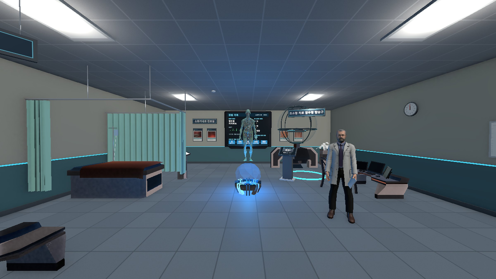
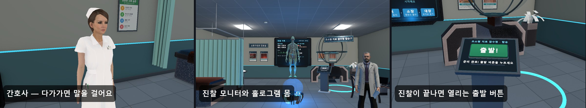
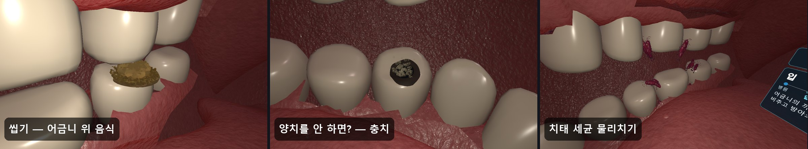
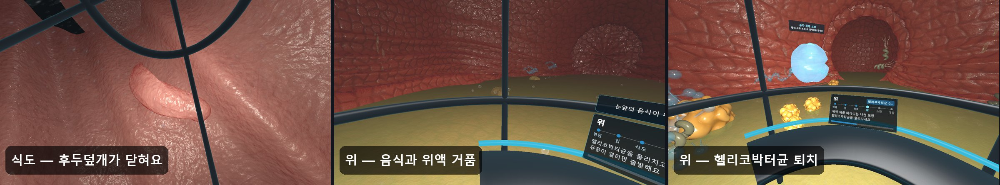
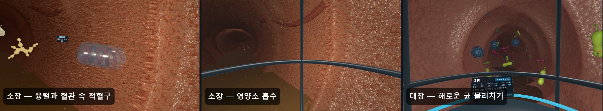
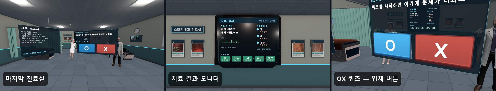
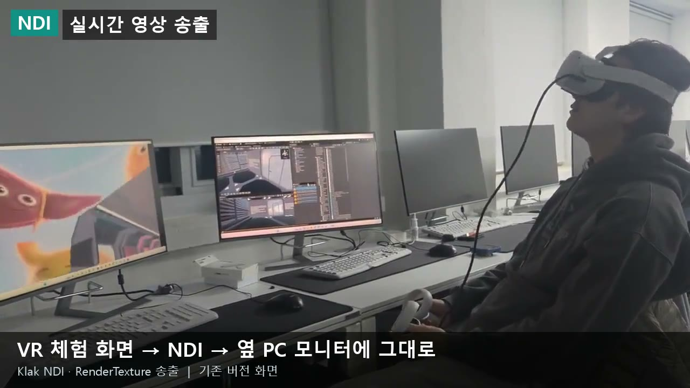

# 인체탐험 VR — 몸속 치료 잠수정

> 이가 시리고 배가 아픈 환자를 진찰한 뒤, 초소형 치료 잠수정을 타고 몸속으로 들어가 **입에서 대장까지 아픈 곳을 직접 고치는** Meta Quest VR 교육 체험입니다.
> 소화기관을 그림으로 외우지 않고, 안에 들어가 **보고 · 겨누고 · 고치며** 배웁니다.




- **대상**: 체험관 어린이 관람객 (아이 눈높이 대사, 앉아서 체험 · 왼손잡이 설정 지원)
- **플랫폼**: Meta Quest 2/3 (Android 단독 실행) · PC (Quest Link)
- **한 회차**: 약 15분 — 병원 진료실 → 몸속 5곳 → 마지막 진료실

---

## 목차

1. [체험 순서](#체험-순서)
2. [장면별 모습](#장면별-모습)
3. [주요 시스템](#주요-시스템)
4. [시작하기](#시작하기)
5. [프로젝트 구조](#프로젝트-구조)
6. [에셋 파이프라인 · 도구](#에셋-파이프라인--도구)
7. [외부 연동 — NDI · OSC](#외부-연동--ndi--osc)
8. [시연 영상](#시연-영상)
9. [크레딧 · 라이선스](#크레딧--라이선스)

---

## 체험 순서

| # | 장소 | 하는 일 (임무) | 만나는 것 |
|:-:|---|---|---|
| 0 | **병원 진료실** | 간호사와 대화 → 의사 선생님께 진찰 → 홀로그램 몸의 빨간 점 3곳(이 · 위 · 대장) 겨누기 → 출발 버튼 | 간호사, 의사, 진찰 모니터, 잠수정 탑승구 |
| 1 | **입** | 꼭꼭 씹기 → "양치를 안 하면?" 시간 흐름 → 충치 치료 → 치태 세균 물리치기 → 꿀꺽 삼키기 | 치아 32개, 혀, 침샘 · 흐르는 침, 충치 |
| 2 | **식도** | 잠수정으로 내려가며 거꾸로 올라오는 위산 방울 중화 | 후두덮개, 연동 운동 고리, 분문 |
| 3 | **위** | 위액 위를 떠다니는 헬리코박터균 물리치기 → 유문이 열릴 때까지 관찰 | 위 주름, 위액 거품, 음식 → 미즙 |
| 4 | **소장** | 효소 짝 맞추기(녹말 · 단백질 · 지방) → 영양소 흡수 관찰 | 융털 5만여 개, 혈관 속 적혈구, 지방산 |
| 5 | **대장** | 해로운 균 물리치기(유익균은 지키기) → 유익균에게 식이섬유 먹이기 | 유익균 · 해로운 균, 수분 흡수, 굳어 가는 찌꺼기 |
| 6 | **마지막 진료실** | 치료 결과 확인 → OX 퀴즈 → 치료 보고서 → 처음으로 | 치료 결과 모니터, 입체 O · X 버튼 |

```
00_Lobby(병원) → 01_Mouth → 02_Esophagus → 03_Stomach → 04_SmallIntestine → 05_LargeIntestine → 06_Theater(마지막 진료실)
```

임무를 다 하면 다음 장면으로 넘어가고, 체험관 회차 시간을 지키기 위해 시간이 다 되면 임무를 못 끝내도 넘어갑니다.

---

## 장면별 모습

### 병원 진료실 — 진찰



간호사 머리 위 **할 일 말풍선**을 따라 대화하고, 홀로그램 몸의 빨간 점을 겨누면 진찰 모니터가 삐빅 소리와 함께 증상의 원인(충치 · 헬리코박터균 · 해로운 균)을 보여 줍니다. 세 곳을 다 찾으면 출발 버튼이 열립니다.

### 입 — 충치와 치태



방아쇠로 턱을 움직여 씹고, 시간을 빨리 돌려 충치가 생기는 과정을 본 뒤, 파란 치료 광선으로 충치를 메우고 이 사이 세균을 물리칩니다.

### 식도 · 위



잠수정 좌석에 앉아 식도를 내려가며 역류하는 위산을 중화하고, 위에서는 나선 모양 헬리코박터균을 물리친 뒤 유문이 열리면 소장으로 갑니다.

### 소장 · 대장



소장에서는 효소와 영양소의 짝을 맞추고 융털로 흡수되는 모습을 관찰합니다. 대장에서는 해로운 균만 골라 물리치고(유익균을 맞히면 말립니다), 유익균에게 식이섬유를 먹입니다.

### 마지막 진료실 — 치료 결과



치료 전 증상과 부위별 치료 완료를 확인하고, OX 퀴즈와 치료 보고서로 마무리합니다.

---

## 주요 시스템

| 영역 | 핵심 스크립트 | 내용 |
|---|---|---|
| 진행 · 임무 | `JourneyManager` `OrganStage` `MissionGate` | 장면 순서는 `OrganStage` 데이터로만 결정. 페이드 · 도착 자리 · 입장/퇴장 대사를 한곳에서 처리. 페이드는 실제 시간 기준으로 직접 그림 |
| 대사 · 음성 | `GuideNarrator` `HospitalNpc` | 모든 대사는 `Assets/Data/journey_content.json` 한 파일. 화자별 음성(안내 · 간호사 SunHi, 의사 InJoon). 새 말이 시작되면 하던 말을 끊음 |
| 병원 사람들 | `HospitalNpc` `JourneyCharacterMotion` | 다가가면 고개를 돌려 바라보고 선택지로 대화. 애니메이션 파일 없이 코드로 뼈를 움직임(숨쉬기 · 몸무게 옮기기 · 두리번 · 손짓) |
| 겨누기 · 표적 | `JourneyAim` `GermBlaster` `CavityTreatment` `TargetHint` | 컨트롤러로 겨누고 방아쇠. 8초 동안 못 맞히면 남은 표적에 노란 고리, 화면 밖이면 화살표 |
| 화면 표시 | `JourneyHud` `GoalCallout` `DepthButton` | 시야 왼쪽 위엔 진행 점만 고정. 할 일은 캐릭터 머리 위 말풍선. 버튼은 가리키면 틱 소리 나는 입체 버튼 |
| 이동 · 멀미 | `ComfortLocomotion` `ComfortVignette` | 순간이동 대신 걷기(왼쪽 막대 1.5 m/s, 오른쪽 막대 부드러운 회전 60°/s). 잠수정이 움직이는 동안 눈앞 테두리로 시야를 살짝 좁힘 |
| 몸속 표현 | `JourneyMucosa` 셰이더 · `BodyHeadlamp` `VilliCarpet` | 젖은 반사 · 흐르는 막 · 혈관 무늬 점막(가까운 벽 눈부심 한도). 탐험가 전등. 융털 5만여 개를 눈 11m 안 구간만 그림 |
| 소리 | `Footsteps` `JourneyMusic` `Sfx` | 효과음 · 배경 음악 모두 직접 합성. 병원/몸속 발소리 구분, 말소리 · 장면 이동 중 음악 줄임 |
| 체험관 운영 | `ExhibitionSession` `SpectatorView` | 대기 화면 · 회차 시간 · 자동 초기화. 관람객 화면은 체험자 시점을 부드럽게 따라가 PC 모니터에 표시 |

### Quest 최적화

- **세균 · 바이러스 가벼운 판** — Meshy 모형(1만 2천 삼각형)을 UV를 지키며 줄이고 뼈 가중치를 옮겨 씀 → 대장 장면 **96만 → 53만 삼각형**
- **융털** — 5만여 개 중 눈 11m 안 구간만 그림
- **성능 어림** — 장면마다 삼각형 · 그리기 수를 세어 Quest 2 기준(75만 · 200)과 비교 (`Tools/realism_budget.txt`)

---

## 시작하기

### 개발 환경

| 항목 | 버전 |
|---|---|
| Unity | **6000.2.1f1** (Android Build Support 포함) |
| Render Pipeline | URP 17.2 |
| XR | Meta XR SDK 83.0 · XR Interaction Toolkit 3.2 · OpenXR 1.15 |
| 모델 불러오기 | glTFast 6.14 |
| 외부 연동 | Klak NDI 2.1.6 · OscJack 2.0.0 |
| 도구 스크립트 | Python 3 (`edge-tts`, `pymeshlab`, `Pillow`) |

### 열고 실행하기

1. Unity Hub에서 `6000.2.1f1`로 프로젝트를 엽니다.
2. `Assets/Scenes/Journey/00_Lobby.unity`를 열고 Play — 중간 장면에서 Play 해도 영속 프리팹(`PersistentBootstrap`)이 매니저 · 플레이어를 만들어 줍니다.
3. 장면을 처음부터 다시 만들 때는 메뉴 **인체탐험 → 전체 생성 (자료 → 장면 → 빌드 등록)** 을 누릅니다.

### 조작

| | Quest 컨트롤러 | 에디터 (헤드셋 없을 때) |
|---|---|---|
| 걷기 | 왼쪽 막대 | `W` `A` `S` `D` |
| 둘러보기 | 머리 / 오른쪽 막대 회전 | `J` `L` · `I` `K` |
| 겨누기 · 누르기 | 컨트롤러로 가리키고 방아쇠 | 마우스로 가리켜 클릭 (`Space`도 방아쇠) |

### Quest 빌드

1. `File > Build Profiles` → **Android**, `XR Plug-in Management` → **Oculus** 체크
2. Quest를 USB로 연결(개발자 모드) → **Build And Run**
3. PC로 볼 때는 Build Profile을 **Windows**로 바꾸고 Quest Link / Air Link 연결

### 체험관 설정 — `Assets/StreamingAssets/exhibition.json`

```jsonc
{
  "attractMode": true,        // 대기 화면에서 시작
  "sessionMinutes": 15,       // 한 회차 시간
  "idleResetSeconds": 120,    // 헤드셋을 벗고 가만히 있으면 처음으로
  "seated": false,            // 앉아서 체험
  "seatedEyeRaise": 0.45,
  "leftHanded": false,        // 왼손잡이
  "subtitleScale": 1.0,       // 자막 크기
  "spectatorView": true       // PC 모니터에 관람객 화면
}
```

---

## 프로젝트 구조

```
HUMANBODY/
├── Assets/
│   ├── Scenes/Journey/        지금 버전 7개 장면 (00_Lobby ~ 06_Theater, 에디터 코드로 생성)
│   ├── Scripts/Journey/       런타임 스크립트 (진행 · 임무 · NPC · 겨누기 · HUD · 소리 …)
│   │   └── Editor/            장면 생성 JourneyBuilder, 실사화 JourneyRealism.*, 자동 검사 JourneyValidation
│   ├── Data/                  journey_content.json(대사 · 임무), Stages/(OrganStage), Generated/(프리팹 · 재질)
│   ├── Models/                Meshy/(몸속 부위 GLB), Sketchfab/(치아 · 의사 · 간호사)
│   ├── Sounds/Narration/      대사 음성 (edge-tts)
│   ├── Shaders/               점막 · 침 · 흐르는 액체 · 관찰창 유리 · 멀미 완화 테두리
│   ├── Resources/Sfx/         효과음 · 배경 음악 (직접 합성)
│   ├── StreamingAssets/       exhibition.json (체험관 설정)
│   └── Scenes/, Scripts/      예전 버전 (MouseScene · OrganScene · SmallIntestine · Toilet)
├── Tools/                     에셋 생성 · 검사용 Python 스크립트, 자동 촬영 결과
└── docs/                      플레이 점검 기록, README 이미지
```

장면은 손으로 배치하지 않고 에디터 코드(`JourneyBuilder` → `JourneyRealism`)로 만듭니다. 대사나 모형을 바꾸면 메뉴로 다시 적용합니다.

---

## 에셋 파이프라인 · 도구

| 메뉴 · 도구 | 하는 일 |
|---|---|
| `인체탐험/전체 생성 (자료 → 장면 → 빌드 등록)` | 대사 · 단계 데이터 불러오기 → 7개 장면 생성(실사화 포함) → 빌드 목록 등록 |
| `인체탐험/7. 실사 점막과 몸속 조명 적용` | 점막 셰이더 · 잠수정 · 부위 배치 · 임무 · UI 적용 |
| `인체탐험/지금 장면만 다시 적용` · `병원 두 장면만 다시 적용` | 일부 장면만 다시 적용 |
| `인체탐험/장면 촬영 (검수용 이미지)` | 장면별 검수 이미지 촬영 |
| 배치 `JourneyValidation.Run -journeyMode journey` | 처음부터 끝까지 자동 진행 검사 + 실행 중 촬영(`-journeyShots Tools/play_captures`) |
| `Tools/meshy.py` | Meshy text-to-3D 모형 생성 (매니페스트 `Tools/meshy_manifest*.json`) |
| `Tools/make_narration.py` | 대사 → 음성 (edge-tts, 없는 파일만 생성) |
| `Tools/make_sfx.py` | 효과음 · 배경 음악 합성 |
| `Tools/make_lite_models.py` | 세균 모형 가벼운 판 만들기 (pymeshlab) |
| `Tools/compile_check.py` | Unity 없이 C# 컴파일 확인 |

> 배치 모드 검사는 Unity 에디터가 이 프로젝트를 열고 있지 않을 때만 실행됩니다.

---

## 외부 연동 — NDI · OSC



| 구분 | 내용 |
|---|---|
| NDI 영상 송출 | Klak NDI의 `NdiSender`가 RenderTexture를 같은 네트워크로 송출해, 체험자가 보는 VR 화면을 옆 PC 모니터(또는 OBS)에 실시간으로 띄움 — 예전 버전 4개 장면에 적용 |
| OSC 입력 | OscJack 기반 `OSCBodyManager`가 `/input/a` · `/input/b` 버튼 입력을 주고받음. 콜백은 메인 스레드 큐에서 프레임당 최대 50개 처리 |
| 지금 버전 | 관람객 화면은 같은 PC 모니터 출력(`SpectatorView`). 새 7개 장면에는 NDI를 아직 붙이지 않음 |

---

## 시연 영상

- 예전 버전(병아리 의사 · 보트) 전체 시연: [YouTube](https://www.youtube.com/watch?v=oTahLEX3NXo)
- 지금 버전 영상은 헤드셋 확인이 끝나면 올릴 예정입니다.

<details>
<summary><b>개발 기록</b></summary>

| 날짜 | 내용 |
|---|---|
| 2026-05 | 첫 버전 — 병아리 의사 · 보트 · 4개 장면, OSC · NDI |
| 2026-09 | 전면 리뉴얼 — 7개 장면 구조, Meshy 생성 모형으로 교체, 에디터 코드로 장면 생성 |
| 2026-10 | 입 장면 부위 배치를 해부학 기준으로 다시 맞춤 (맞물림 · 접촉 거리 수치 검사) |
| 2026-11 | 실사 점막 셰이더, 병원 진료실 이야기 · 장면별 치료 임무, 사람 의사 · 간호사, 걷기 이동, 효과음 · 배경 음악, 화면 표시 개편(진행 점 · 말풍선 · 표적 힌트), Quest APK 빌드 |

최근 점검 내용은 [docs/플레이점검_2026-11-05.md](docs/플레이점검_2026-11-05.md)에 있습니다.

</details>

---

## 크레딧 · 라이선스

| 에셋 | 출처 | 라이선스 |
|---|---|---|
| 몸속 부위 모형 54개 | Meshy text-to-3D로 생성 | Meshy 생성물 |
| 치아 `HumanTeeth.glb` | Sketchfab — Alexander Antipov (Dessen) | CC BY 4.0 |
| 의사 `Doctor.glb` | Sketchfab — BrushDip | CC BY 4.0 |
| 간호사 `Nurse2.glb` | Sketchfab — Diddy_Blud_117 | CC BY 4.0 |
| 진료실 소품 | Sci-Fi Styled Modular Pack | 무료 에셋 |
| 입체 버튼 그림 | Kenney UI | CC0 |
| 음성 | edge-tts (SunHi · InJoon) | — |
| 효과음 · 배경 음악 | 직접 합성 | — |

CC BY 모형의 출처는 마지막 진료실의 만든 사람 안내에도 표시합니다.
이 저장소는 학습 · 포트폴리오 목적으로 공개합니다. Meta XR SDK 등 외부 에셋과 패키지는 각 라이선스를 따릅니다.

---

**만든 사람** — 오정훈 ([@jeonghun267](https://github.com/jeonghun267)) · PolyTech
