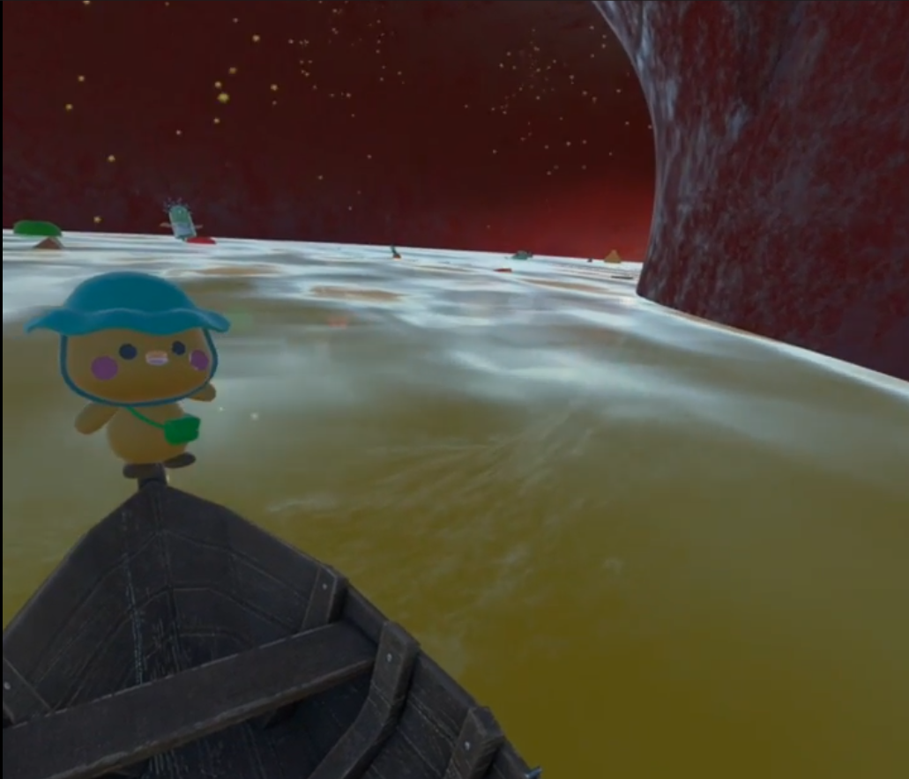

<div align="center">

# 인체탐험 VR (HUMANBODY)

**보트를 타고 소화기관 속을 여행하며 인체를 배우는 Meta Quest VR 교육 콘텐츠**




[▶ 유튜브 시연 영상 보기](https://www.youtube.com/watch?v=oTahLEX3NXo)

</div>

---

## 프로젝트 소개

기존 VR 박물관은 전시품 화면과 설명 글을 보여 주는 데 그쳐 몰입감과 학습 효과가 낮다는 한계가 있었습니다. 이 프로젝트는 **생성형 AI**와 **VR**을 결합해, 관람자가 직접 **소화기관 안을 여행**하며 능동적으로 배우는 교육 콘텐츠로 설계했습니다.

병아리 의사 NPC가 가이드로 따라다니며 기관마다 음성과 UI로 설명하고, 사용자는 **보트를 타고 식도 → 위 → 소장 → 대장** 순서로 이동합니다. 마지막에는 AI로 만든 영상이 360도 상영관에서 재생되어 배운 내용을 정리해 줍니다.

| 항목 | 내용 |
|---|---|
| 형태 | 개인 프로젝트 |
| 엔진 | Unity 6000.2.1f1 (Unity 6), URP |
| 대상 기기 | Meta Quest 2/3 (Android), PC (Quest Link) |
| XR | Meta XR SDK, Unity XR Interaction Toolkit |
| 입력 | OVRInput, Unity Input System |
| 연동 | OSC(관람 상태 동기화), NDI(영상 송출) |
| 주요 패키지 | Cinemachine, KinoBloom, NamuFX, ToonyColorsPro, KoreanTyper |

---

## 주요 기능

### 1. 가이드 NPC (병아리 의사)
- `NPCController`: 플레이어 시선 옆 일정 거리에서 따라오는 싱글톤 NPC
- `FloatingFollower`: 부드러운 부유·회전(Lerp), VR `CenterEyeAnchor` 자동 추적
- `NPCUI` / `NPCUILook`: World Space UI가 항상 카메라를 향하도록 회전
- `DoctorController`: 기관별 음성(`Resources/Explain_{OrganName}.mp3`)을 공간 음향으로 재생

### 2. 보트 이동 (소화기관 여행)
- `BoatInteraction`: VR A/X 버튼(PC는 `E`)으로 탑승·하차, 플레이어와 NPC를 함께 보트에 붙임
- `SimpleTrainMover` + Cinemachine `SplineCart`: 식도 → 위 → 장 경로를 따라 자동 이동
- 거리 기반 상호작용으로 자연스럽게 탑승

### 3. 씬 전환
- `SceneChanger`: 트리거에 들어가면 OVRScreenFade와 UI 페이드 후 비동기 씬 로드
- `VRPlayerManager`: `DontDestroyOnLoad` 플레이어가 씬이 바뀔 때 `SpawnPoint`로 위치 보정
- `SceneLoader` / `SceneTransitionCleaner`: 씬 사이 자원 정리

### 4. 위치 기반 설명과 상호작용
- `AutoGuideTrigger`: 카메라가 기관 영역에 들어가면 해당 설명 자동 재생
- `RaycastInteractor` / `VRGazeInteractor`: 시선·광선으로 전시물 선택, `DisplayInfo`로 정보 패널 표시
- `LocationTrigger` / `ChickSpeechTrigger`: 위치별 NPC 대사와 효과음

### 5. 환경 연출
- `FluidBobber`: 위액 표면 위에 떠 있는 효과
- `DescentTransition`: 식도를 내려가는 연출
- `VirusGroupController`: 바이러스마다 속도·축·범위를 무작위로 줘서 자연스러운 군집 움직임
- `AutoDoor` / `AutoRotate`: 트리거 기반 자동 문과 회전 오브젝트

### 6. 외부 연동 (OSC / NDI)
- `OSCManager`: `/interaction/{organID}` 주소로 다른 헤드셋·시연 컨트롤러와 관람 상태 공유
- `OSCBodyManager`: 외부 모션 캡처·바디 트래킹 데이터 수신용 인터페이스

---

## 기술적으로 고민한 점

| 문제 | 해결 |
|---|---|
| 씬이 바뀔 때마다 VR 플레이어가 다시 초기화됨 | `VRPlayerManager` 싱글톤으로 플레이어를 유지하고 `SpawnPoint`에 자동 정렬 |
| 씬 전환 때 화면이 깜빡임 | `OVRScreenFade`와 UI Canvas 페이드를 함께 맞춰 깜빡임 제거 |
| 보트에 탈 때 충돌로 몸이 튐 | `SetParent` 하는 동안 `CharacterController`를 잠시 꺼서 충돌 회피 |
| 여러 명이 동시에 관람할 때 상태가 따로 놂 | OSC로 지금 보고 있는 기관을 다른 헤드셋에 전달 |
| 바이러스 무리 움직임이 기계적으로 보임 | 개체마다 축·속도·범위·회전 방향을 모두 무작위화 |

---

## 콘텐츠 진행 흐름

```
로비 입장 (병아리 가이드 등장)
   ↓
입 · 식도 (MouseScene) ── 소화 시작 설명, 보트 탑승
   ↓
위 (OrganScene) ── 위액 표면 효과, 음식 분해 시연
   ↓
소장 (SmallIntestine) ── 영양소 흡수, 바이러스 상호작용
   ↓
대장 (Toilet) ── 마무리 연출
   ↓
360도 상영관 ── AI로 만든 정리 영상
```

## 프로젝트 구조

```
Assets/
├── Scenes/      # MouseScene → OrganScene → SmallIntestine → Toilet
├── Scripts/     # NPC, 씬 전환, 보트, 문, OSC 등 게임 로직
├── Prefabs/     # 재사용 오브젝트
├── Character/   # 캐릭터 모델·애니메이션
├── Enviroment/  # 배경 환경
├── Boats/       # 보트·스플라인
├── Sounds/      # 배경음·효과음·내레이션
├── Resources/   # 런타임 로딩 (음성 클립 등)
├── NDI/         # 영상 송출
└── Settings/    # URP 렌더러·볼륨
```

## 빌드 방법

**Meta Quest (Android)**
1. Unity Hub에서 `6000.2.1f1`과 **Android Build Support**를 설치합니다.
2. `File > Build Profiles`에서 **Android**를 선택합니다.
3. `XR Plug-in Management`에서 **Oculus**를 켭니다.
4. 개발자 모드를 켠 Quest를 USB로 연결하고 `Build And Run`을 누릅니다.

**PC (Quest Link)**
1. Build Profile을 **Windows**로 바꿉니다.
2. Quest를 Quest Link 또는 Air Link로 연결하고 `Build And Run`을 누릅니다.

## 개발 흐름

- `jeonghun` 브랜치에서 작업하고, 빌드·실행으로 에러가 없는지 확인한 뒤 `main`에 머지합니다.
- `main`은 항상 실행 가능한 상태로 유지합니다.

## 개발자

- **오정훈** ([@jeonghun267](https://github.com/jeonghun267)) · 한국폴리텍대학 컴퓨터공학과
- 포트폴리오: https://jeonghun267.github.io/

## 라이선스

학습·포트폴리오 목적으로 공개합니다. 일부 에셋(Meta XR SDK, ToonyColorsPro, NamuFX, Yughues Free Fur Materials, Sketchfab 모델 등)은 각 라이선스를 따릅니다.
