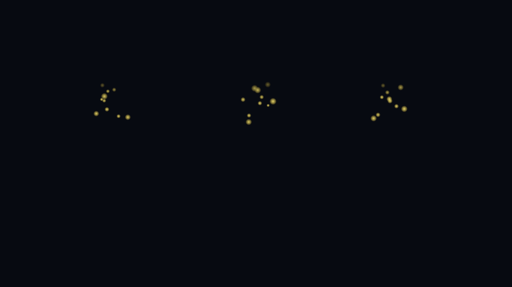
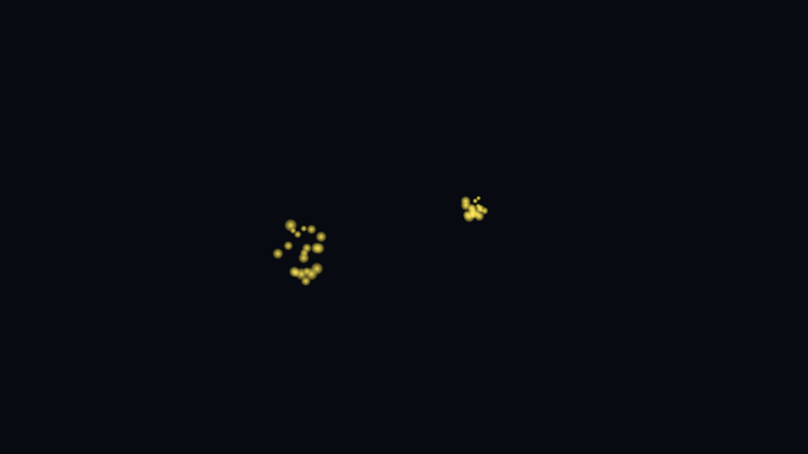

# 소화·흡수 효과 구현 결과

작성일: 2026년 9월 22일

빠져 있던 영양소 흡수 빛과 수분 흡수 파문을 구현하고, 위산과 소화 효과음을 소화 시작·완료 시점에 연결했다. 실제 위·소장·대장 장면에 저장했으며, 장면을 다시 만드는 기능에도 같은 연결을 추가했다.

## 구현 내용

| 위치 | 동작 |
|---|---|
| 위 | 소화가 시작되면 세 곳에서 위산 방울이 나오고 소화 효과음이 재생된다. 위벽 수축과 음식의 미즙 변환이 끝나면 방출과 소리가 멈추며 남은 입자는 자연스럽게 사라진다. |
| 소장 | 영양소가 흡수 지점에 도착할 때 금빛 입자 스무 개가 퍼진다. 연속 흡수 시 앞서 발생한 입자는 원래 위치에 남고, 새 입자는 새 흡수 지점에 생긴다. |
| 대장 | 물방울이 장벽의 흡수 경계에 닿으면 하늘색 고리가 벽면 방향에 맞춰 퍼지며 사라진다. 여러 물방울이 동시에 흡수되어도 각각의 파문이 유지된다. |

소화를 중간에 끄면 위산·소리·위벽 수축을 정리하고 음식과 미즙의 기존 상태를 복구한다. 다시 켜서 소화를 시작할 수 있으며, 중단된 소화에서 완료 신호가 잘못 발생하지 않는다.

기존 위산 그래프의 원본 자산은 보존했다. 장면 안의 기존 그래프 개체를 비활성화하고 새 입자 효과로 연결해 중복 자동 재생과 장면 해제 시 정리 오류를 해결했다.

## 확인 결과

| 검사 | 결과 | 기록 |
|---|---|---|
| 세 장면의 효과 연결·저장 및 입자 셰이더 컴파일 | 모두 통과 | [연결 검사](effect_setup_validation.txt) |
| 실제 재생 상태의 효과 동작 | 34개 통과, 실패 0 | [효과 검사](effect_effects.txt) |
| 로비부터 전체 탐험을 거쳐 로비로 복귀 | 30개 통과, 실패 0 | [전체 진행 검사](effect_journey.txt) |

효과 검사는 중복 소화 시작, 중간 중단과 재시작, 연속 영양소 흡수, 물방울 파문의 위치와 방향, 입자 소멸, 장면 해제 후 정리를 확인했다. 전체 진행 검사는 씹기·삼킴, 탑승, 유문 개방, 영양소 전체 흡수, 상영관의 대체 종료, 최초 플레이어와 영속 관리자의 유지를 확인했다.

검사는 유니티 편집기에서 대기 시간과 이동 시간을 줄여 실행했다. 실제 머리 착용 장치의 양안 화면, 손·컨트롤러 입력, 청취 음질, 기기 성능은 이번 검사에 포함되지 않는다. 기존 기기 초기화 환경의 미해결 사항은 [이전 검증 기록](VALIDATION.md)에 남겨 두었다.

## 실행 중 촬영한 효과

아래는 실제 재생 중인 입자를 별도 카메라로 촬영한 모습이다. 효과를 알아보기 쉽도록 다른 개체를 가린 검사용 화면이며, 탐험 장면 전체나 장치 화면을 촬영한 것은 아니다.

### 위산 분비

### 영양소 흡수

### 수분 흡수

## 편집기에서 확인

위·소장·대장 장면의 소화 및 흡수 구성 요소에 효과 연결을 저장했다. 연결을 다시 설정할 때는 편집기 메뉴의 **인체탐험 → 5. 흡수와 위산 효과 연결**을 사용한다.

수정 전 스크립트와 장면의 백업은 작업 폴더의 `vfx-completion/original`에 보관했다. 실제 장치 확인 시에는 일반 탐험 속도로 소화를 시작하고, 영양소를 연속으로 흡수하며, 대장 탑승 중 파문이 보이는지 확인하면 된다.
