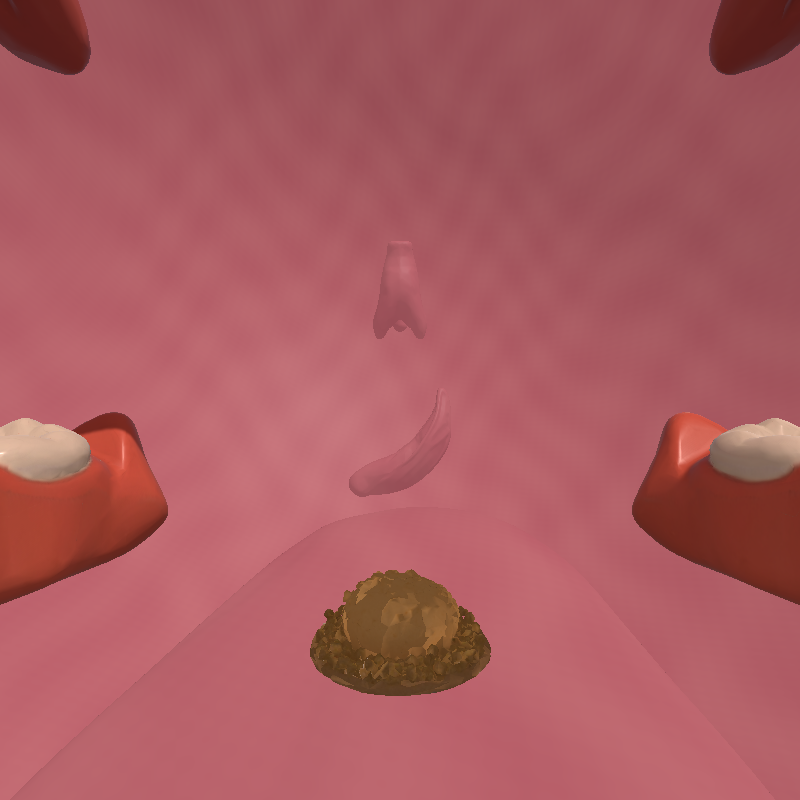
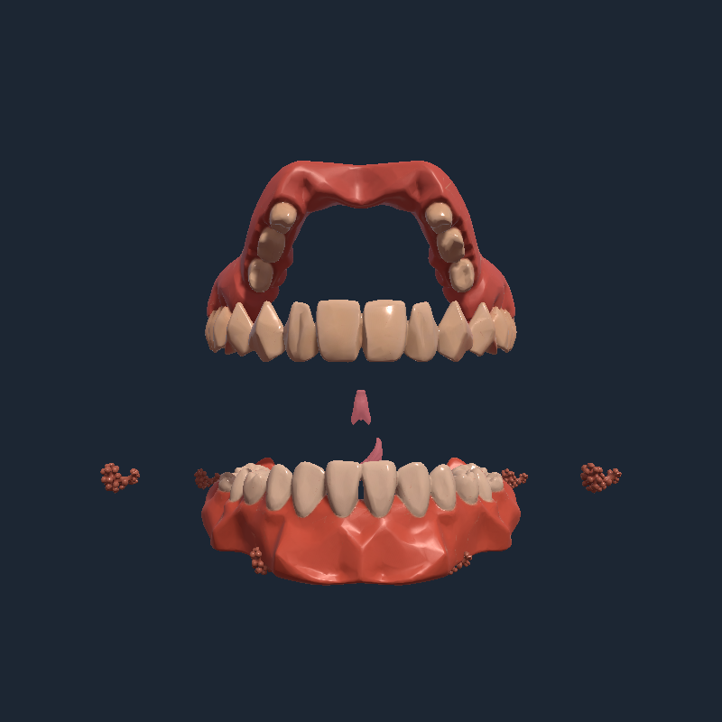
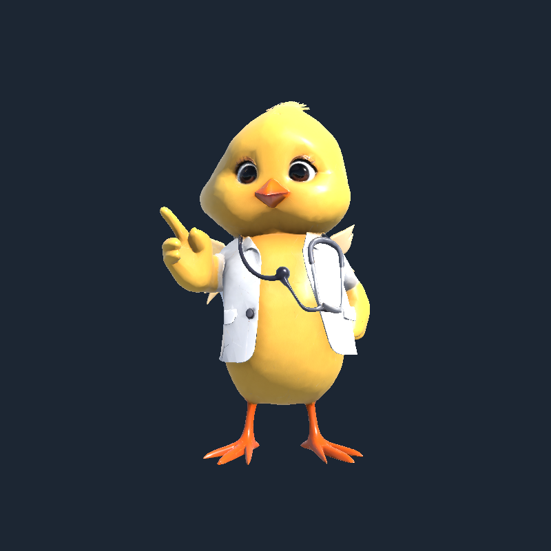
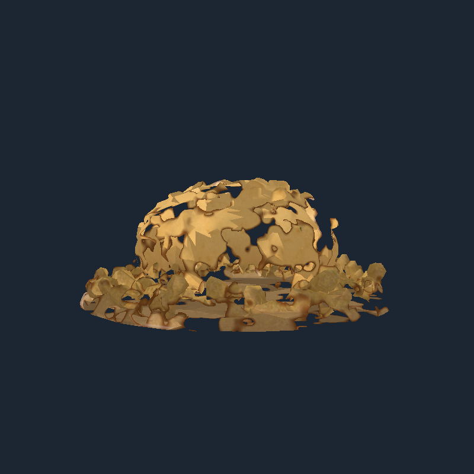

# 수정 화면

원본 프로젝트에 반영을 완료했다. 아래는 실제 장면 자료로 촬영한 점검 화면이다. 헤드셋에서 체감하는 시야와 성능은 별도 확인이 필요하다.

## 입 안의 탐험자 시점

회오리 배경을 제거했고 혀를 낮춰 앞을 볼 수 있게 했다. 음식과 기관 표면의 과한 얼룩도 정리했다.

## 위아래 치열 방향

방향을 비교하기 위해 주변 벽과 혀를 잠시 숨기고 촬영한 점검 화면이다. 실제 장면에서는 벽과 혀가 함께 표시된다.

## 캐릭터의 관절 동작

안내자의 머리·부리·팔·날개가 따로 움직인다. 아래는 관절 동작 중의 모양을 확인한 화면이다.

## 음식 표면 분해

분해 진행도에 따라 표면이 사라지고 미즙으로 전환된다.

## 검사 결과

- 원본: 보완 동작 36개, 전체 탐험 왕복 30개 통과.
- 검증 사본: 기존 효과 34개, 이동·안내 회귀 15개도 통과.
- 식도·소장·대장 각각 이동 경로 아홉 지점에서 사방 벽 연결과 간격 확인.
- 배경의 방사형 무늬 제거, 다섯 셰이더 컴파일, 일곱 캐릭터의 관절 가중치와 변형 검사 통과.

[전체 보완 내용](POLISH.md) · [원본 동작 검사](polish_polish.txt) · [원본 탐험 검사](polish_journey.txt)
